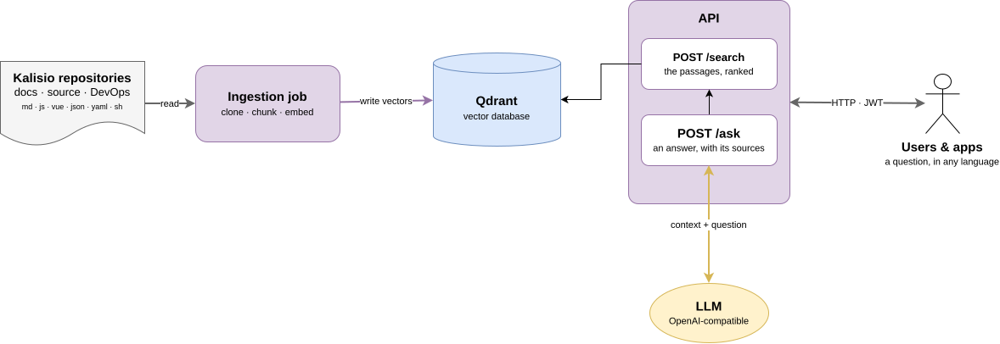
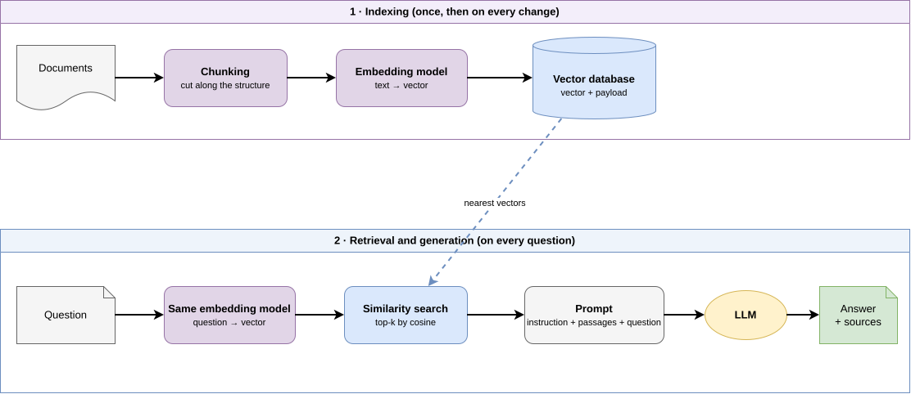
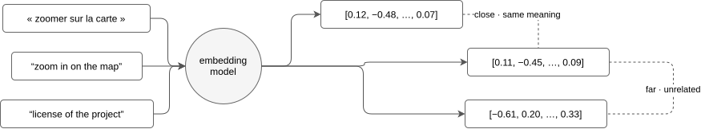
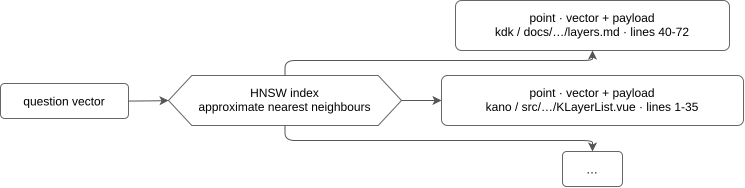
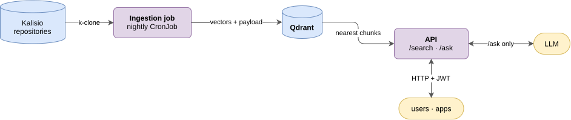

# About

**knowledge** is a [retrieval-augmented generation (RAG)](https://www.ibm.com/fr-fr/think/topics/retrieval-augmented-generation) engine specialised in the Kalisio ecosystem. It reads the [Kalisio](https://kalisio.com/) repositories, documentation, source code, DevOps configuration, cuts every file into passages along its own structure, turns each passage into a vector, and stores the vectors in a [Qdrant](https://qdrant.tech/) database.

## How a RAG works

A RAG runs in two phases: **indexing**, done once and then on every change of the corpus, and **retrieval + generation**, done on every question.

### The four steps

| Step | What it does | In knowledge |
| --- | --- | --- |
| **Ingestion** | Finds the documents, reads them, keeps the ones worth indexing | [Ingestion job](/guides/ingestion-job) |
| **Vectorisation** | Cuts each document into passages (*chunks*) and turns each one into a vector with an *embedding model* | [File formats](/guides/file-formats/) · [Embedding model](/guides/file-formats/#the-embedding-model) |
| **Semantic search** | Turns the question into a vector with the same model and returns the nearest passage vectors | [`/search`](/guides/api#post-search) · [Qdrant](/guides/qdrant) |
| **Generation** | Gives an LLM an instruction, the retrieved passages and the question, and returns what it writes | [`/ask`](/guides/api#post-ask) |

### Vectors: comparing texts by their meaning

An **embedding model** turns a text into a fixed-length list of numbers, 1 024 of them in knowledge, its coordinates in a *space of meaning*. The model is trained so that texts which mean the same thing land close together, whatever words they use, and, for a multilingual model, whatever language they are written in.

### The role of the vector database

Comparing a question with every passage one by one is fine for a thousand passages, too slow for millions. A **vector database** stores the vectors with their *payload* (the text, the file, the lines) and finds the nearest ones fast, with an approximate index, [HNSW](https://www.pinecone.io/learn/series/faiss/hnsw/) in Qdrant's case, a graph of vectors navigated from coarse to fine. It also filters on the payload, and lets the ingestion job update or delete the passages of a single file.

### Generation: the LLM only reads what it is given

The LLM does not search. It receives an instruction, the retrieved passages and the question, and writes the answer. A good answer therefore depends first on a good search.

| Piece | What it does |
| --- | --- |
| Embedding model | turns a text into a vector |
| Vector database | finds the *k* nearest vectors |
| LLM | reads instruction + passages + question, writes the answer |

## How knowledge works

knowledge is that pipeline, cut into three components deployed apart:

- the **[ingestion job](/guides/ingestion-job)** clones the repositories, cuts every supported file along its structure, embeds the chunks with [Qwen3-Embedding-0.6B](https://huggingface.co/Qwen/Qwen3-Embedding-0.6B) and writes them to Qdrant, only what changed since the last run
- **[Qdrant](/guides/qdrant)** stores one point per chunk
- the **[API](/guides/api)** embeds a question, and its translations, with the same model, searches Qdrant, and either returns the passages (`/search`) or has an LLM answer from them (`/ask`).
