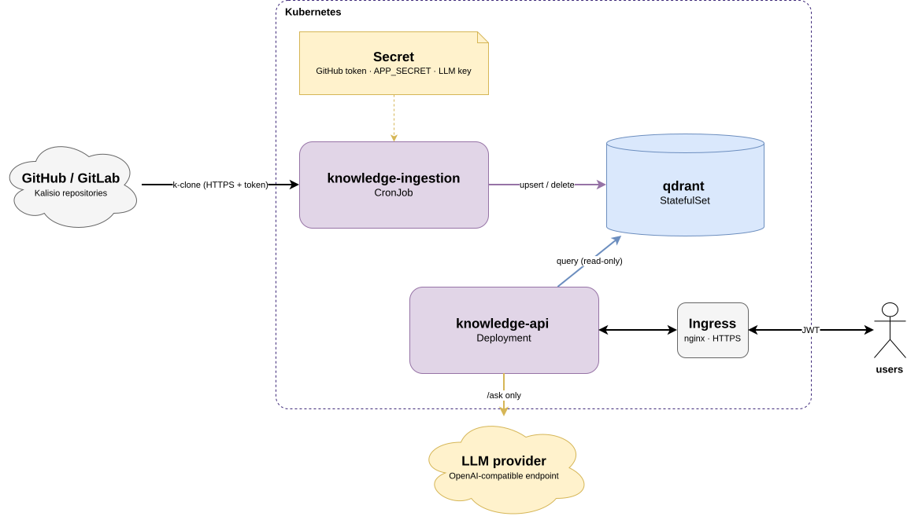
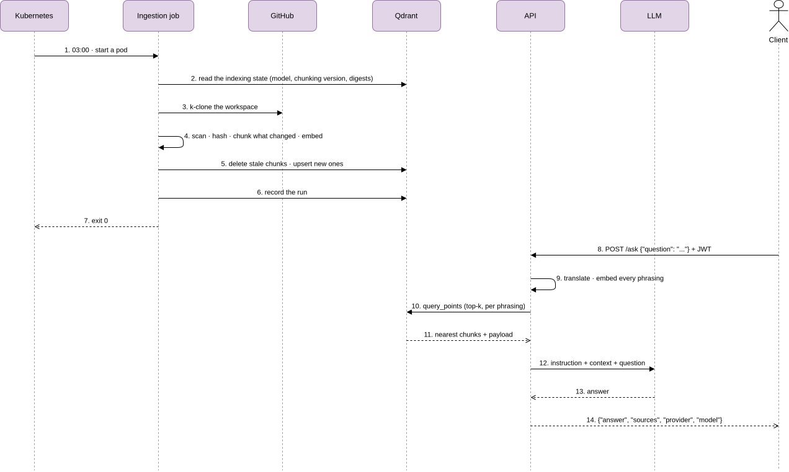
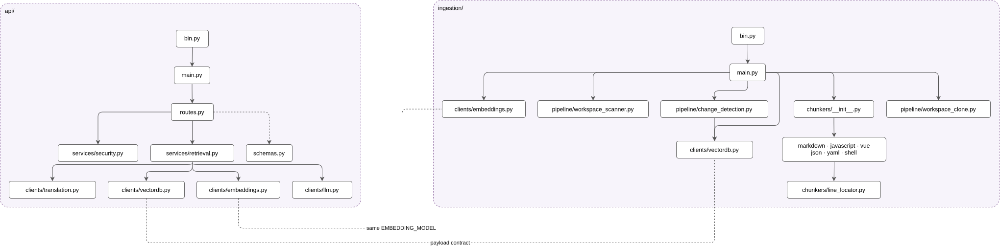
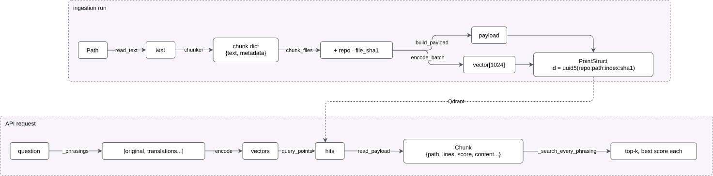

# Architecture

## Functional architecture

### Deployment



:::tip
In the Kalisio clusters, knowledge is three Helm releases, declared in
[`kargo`](https://github.com/kalisio/kargo) (the charts  `knowledge-ingestion` and `knowledge-api` + [Qdrant chart](https://github.com/qdrant/qdrant-helm)) and instantiated per
environment by `helmfile`
:::

### Interactions over time



## Software architecture

### Repository layout

```
knowledge/
├── api/                      the API service ─────────────── image knowledge-api
│   ├── bin.py                  entry point: uvicorn api.main:app
│   ├── main.py                 the FastAPI app: lifespan checks, CORS, 503 handlers
│   ├── routes.py               /health · /ask · /search
│   ├── schemas.py              request and response models (pydantic)
│   ├── config.py               every setting, read from the environment
│   ├── logger.py
│   ├── services/               what the API does
│   │   ├── retrieval.py          phrasings → search → merge → context → LLM
│   │   └── security.py           JWT bearer verification
│   ├── clients/                what the API talks to
│   │   ├── embeddings.py         question → vector (Qwen3 + instruction)
│   │   ├── translation.py        language detection + Marian translation
│   │   ├── vectordb.py           Qdrant, read-only
│   │   └── llm.py                OpenAI-compatible chat completion
│   └── tools/make_jwt.py       mint a dev token
├── ingestion/                the ingestion job ───────────── image knowledge-ingestion
│   ├── bin.py                  entry point: one run, exit code
│   ├── main.py                 the seven steps of a run
│   ├── config.py · logger.py
│   ├── pipeline/               the steps
│   │   ├── workspace_clone.py    k-clone into the workspace
│   │   ├── workspace_scanner.py  git ls-files + filters
│   │   └── change_detection.py   SHA-1 digests: new, edited, deleted
│   ├── chunkers/               one per format + the router
│   │   ├── __init__.py           extension → chunker · CHUNKING_VERSION
│   │   ├── markdown.py javascript.py vue.py json.py yaml.py shell.py
│   │   └── line_locator.py       where a chunk sits in its file
│   └── clients/
│       ├── embeddings.py         chunks → vectors, in batches
│       └── vectordb.py           Qdrant: collections, upserts, deletes
├── test/
│   ├── api/  ingestion/        unit tests, mirroring the two services
│   ├── e2e/                    job + Qdrant + API end to end (needs Qdrant)
│   ├── multilingual/           cross-lingual retrieval quality (needs the model)
│   └── data/                   chunker fixtures · multilingual corpus
├── docs/                     this site (VitePress)
│   ├── about/ guides/ research/
│   ├── experiments/            research code and notebooks (not rendered)
│   ├── drawio/                 the diagram sources (draw.io)
│   └── public/                 images exported from them
├── scripts/                  CI: tests, image builds, docs (kash) · export_diagrams.sh
├── api.Dockerfile · ingestion.Dockerfile
├── pyproject.toml            dependencies (CPU torch) + test and research groups
└── uv.lock                   the pinned versions the CI and the images install
```

### The two services side by side



### Data flow inside a run and a request


