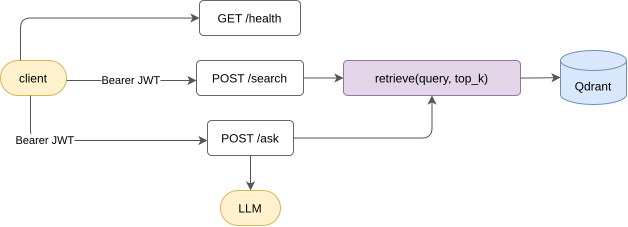
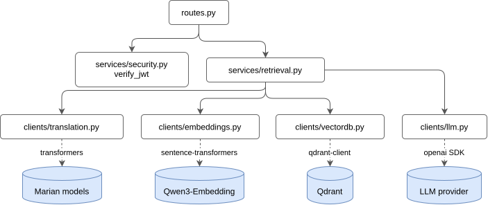
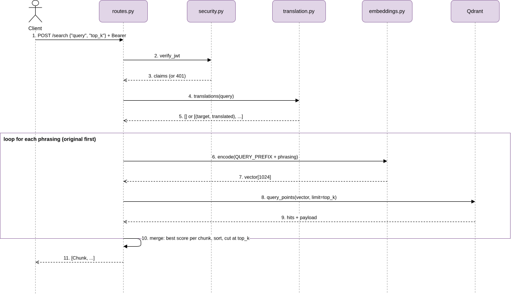
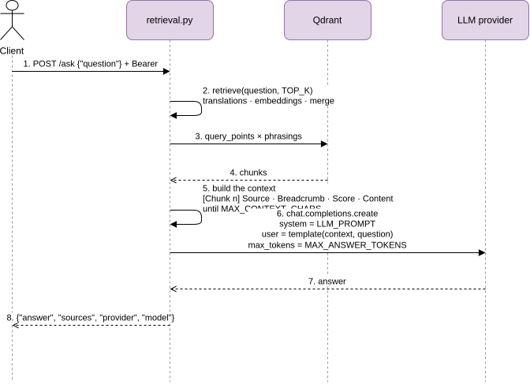
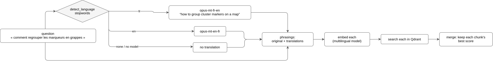

# API

The API **serves the index**. It turns a question into vectors, asks [Qdrant](/guides/components/qdrant) for the nearest chunks, and returns them, or hands them to an LLM and returns its answer.

:::info
It is a [FastAPI](https://fastapi.tiangolo.com/) application served by
[uvicorn](https://www.uvicorn.org/), started with `python -m api.bin`.
:::



:::details Module Structure
```
api/
├── bin.py              uvicorn.run("api.main:app", proxy_headers=True)
├── main.py             create_app(): lifespan checks, CORS, 503 handlers, router
├── routes.py           the three endpoints, JWT dependency
├── schemas.py          AskRequest · AskResponse · SearchRequest · Chunk
├── config.py           Config, from the environment; default prompts
├── services/
│   ├── retrieval.py      retrieve · answer_question · search_chunks
│   └── security.py       verify_jwt
├── clients/
│   ├── embeddings.py     encode(question) with the retrieval instruction
│   ├── translation.py    detect_language · translations · Marian models
│   ├── vectordb.py       search · count_chunks · read_payload (read-only)
│   └── llm.py            ask(prompt) through the OpenAI SDK
└── tools/make_jwt.py   a dev token signed with APP_SECRET
```



:::

## Endpoints

| Method | Path |
| --- | --- |
| `GET` | `/health` |
| `POST` | `/search` |
| `POST` | `/ask` |

### `POST /search` : Semantic search only

| Field | Type | Required | Constraints | Description |
| --- | --- | :-: | --- | --- |
| `query` | string | ✓ | 1–2000 characters | the question, in any language |
| `top_k` | integer | | 1–50, default `5` | how many passages to return |



### `POST /ask` : Retrieval-augmented answer

the same retrieval as `/search` with `top_k = TOP_K`, then the LLM.

| Field | Type | Required | Constraints | Description |
| --- | --- | :-: | --- | --- |
| `question` | string | ✓ | 1–2000 characters | the question, in any language |



## Multilingual retrieval

Retrieval works across languages thanks to two mechanisms:



1. **The embedding model is multilingual.** [Qwen3-Embedding-0.6B](https://huggingface.co/Qwen/Qwen3-Embedding-0.6B) matches questions and passages with similar meanings, even in different languages.
2. **Query translation** [Marian](https://marian-nmt.github.io/) model translate questions to bridge vocabulary gaps (e.g. « grappes » → clusters). The original query is always kept.

## The LLM

`/ask` uses the official [OpenAI Python SDK](https://github.com/openai/openai-python) and the `LLM_ENDPOINT` variable, supporting any provider compatible with the [Chat Completions API](https://platform.openai.com/docs/api-reference/chat) ([Anthropic](https://docs.claude.com/en/api/openai-sdk), [OpenAI](https://platform.openai.com/docs/models), [Mistral](https://docs.mistral.ai/api/) or local [Ollama](https://github.com/ollama/ollama/blob/main/docs/openai.md)).

Only three settings are needed: `LLM_ENDPOINT`, `LLM_MODEL` and `LLM_API_KEY`.

## Environment variables

**Required**

| Variable | Description |
| --- | --- |
| `QDRANT_URL` | Qdrant REST endpoint |
| `QDRANT_COLLECTION_CODE` | collection of the chunks, the one the job writes |
| `EMBEDDING_MODEL` | must be the job's, e.g. `Qwen/Qwen3-Embedding-0.6B` |
| `LLM_ENDPOINT` | base URL of an OpenAI-compatible API |
| `LLM_MODEL` | chat model identifier |
| `LLM_API_KEY` | key for the provider |
| `APP_SECRET` | JWT signing secret, required unless `KNOWLEDGE_AUTH_ENABLED=false` |

**Optional**

| Variable | Default | Description |
| --- | --- | --- |
| `QUERY_TRANSLATION_MODEL` | *(empty: off)* | one Marian model name or several, comma-separated, see [Multilingual retrieval](#multilingual-retrieval) |
| `LLM_PROMPT` | the default system prompt above | system message of `/ask` |
| `TOP_K` | `6` | passages retrieved for `/ask` |
| `MAX_CONTEXT_CHARS` | `14000` | character budget of the context given to the LLM |
| `MAX_ANSWER_TOKENS` | `1024` | `max_tokens` of the completion |
| `KNOWLEDGE_AUTH_ENABLED` | `true` | anything but `false` keeps authentication on |
| `JWT_ALGORITHM` | `HS256` | accepted signature algorithm |
| `JWT_AUDIENCE` · `JWT_ISSUER` | `kalisio` · `kalisio` | expected `aud` and `iss` claims |
| `HOST` · `PORT` | `127.0.0.1` · `8187` | binding; `0.0.0.0` in a container |
| `LOG_LEVEL` | `INFO` | verbosity of the `knowledge.*` loggers |
| `APP_VERSION` | `0.1.0` | version shown in the OpenAPI documentation |
