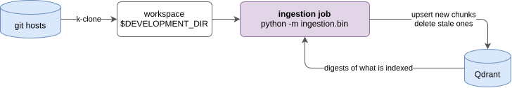
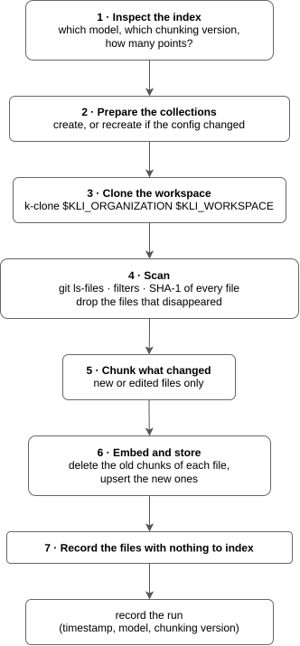
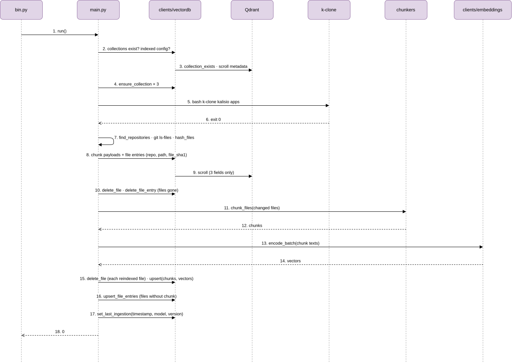
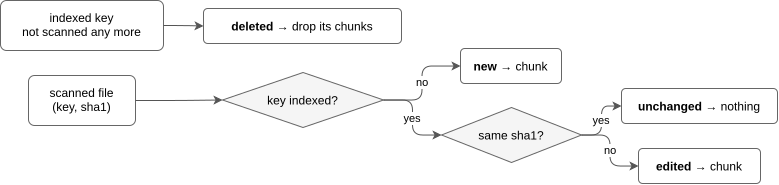

# Ingestion job

The ingestion job **builds and maintains the index**. Each run clones the Kalisio repositories, finds the files worth indexing, cuts the ones that changed into chunks, embeds them and writes them to [Qdrant](/guides/components/qdrant).



:::details Module Structure

```
ingestion/
├── bin.py                    entry point: configure logging, run(), exit code
├── main.py                   run(): the seven steps, timed and logged
├── config.py                 Config: every setting, from the environment
├── logger.py                 the "knowledge" logger, step() timer, durations
├── pipeline/
│   ├── workspace_clone.py      step 3 · link the tooling, run k-clone
│   ├── workspace_scanner.py    step 4 · find repositories, git ls-files, filters
│   └── change_detection.py     steps 4-5 · file keys, SHA-1 digests, what changed
├── chunkers/                 step 5 · one chunker per format, see File formats
└── clients/
    ├── embeddings.py           step 6 · chunks → vectors (sentence-transformers)
    └── vectordb.py             every Qdrant read and write of the job
```
:::

## Pipeline d'ingestion

<p align="center">
  
</p>

:::tip sequence diagram

:::

:::info Step 5: Chunking the files that changed
A file is reindexed when its key is new, or when its digest differs from the indexed one:


:::

## Environment variables

**Required**

| Variable | Description |
| --- | --- |
| `QDRANT_URL` | Qdrant REST endpoint, e.g. `http://qdrant:6333` |
| `QDRANT_COLLECTION_CODE` | collection of the chunks, e.g. `kalisio_code`, the API reads the same |
| `QDRANT_COLLECTION_METADATA` | collection of the run record, e.g. `knowledge_metadata` |
| `EMBEDDING_MODEL` | sentence-transformers model, e.g. `Qwen/Qwen3-Embedding-0.6B`, the API must use the same |
| `DEVELOPMENT_DIR` | the workspace root: one directory per organisation |

**Workspace and cloning**

| Variable | Default | Description |
| --- | --- | --- |
| `KLI_ORGANIZATION` | `kalisio` | organisation passed to `k-clone` (`kalisio`, `irsn`, `airbus`) |
| `KLI_WORKSPACE` | `apps` | kli workspace to clone (`apps`, `libs`, `services`, ..., `all`) |
| `KALISIO_DEVELOPMENT_DIR` | `$DEVELOPMENT_DIR/kalisio` | where `k-clone` finds the tooling and clones the Kalisio repositories |
| `INDEXED_REPOSITORIES` | *(all)* | comma-separated repository names to scan; a name not on disk is skipped |
| `KALISIO_GITHUB_TOKEN` |, | token k-clone clones GitHub repositories with; without it, ssh (needs a key in the container) |
| `GITLAB_IRSN_TOKEN` |, | same, for an IRSN workspace on GitLab |
| `KALISIO_GITHUB_URL` · `GITLAB_IRSN_URL` | *(built from the tokens)* | an explicit clone URL wins over the token |
| `KALISIO_TOOLING_DIR` | `/opt/kalisio` | where the image installs `development` and `kli` |

**Scanning**

| Variable | Default | Description |
| --- | --- | --- |
| `SUPPORTED_FILE_EXTENSIONS` | `md,js,mjs,cjs,vue,json,yaml,yml,gotmpl,sh` | extensions to index |
| `MAX_FILE_SIZE` | `100000` | bytes; larger files are skipped |
| `IGNORED_DIRECTORIES` | `.git,node_modules,dist,build,coverage,.vscode,...` | directory names never scanned (`.github` is *not* ignored: it holds the CI workflows) |
| `IGNORED_FILENAMES` | `package.json,package-lock.json,pnpm-lock.yaml,CHANGELOG.md,...` | file names never indexed |
| `IGNORED_FILE_PATTERN` | `\.(min\|bundle\|chunk)\.\w+$\|-lock\.(json\|yaml)$\|\.(enc\|dec)\.\w+$` | regex on file names: minified bundles, lock files, SOPS secrets |

**Chunking and embedding**

| Variable | Default | Description |
| --- | --- | --- |
| `CHUNK_SIZE` · `CHUNK_OVERLAP` | `500` · `80` | prose: Markdown, JSON, YAML |
| `CODE_CHUNK_SIZE` · `CODE_CHUNK_OVERLAP` | `800` · `120` | code: JavaScript, Vue, shell |
| `EMBEDDING_BATCH_SIZE` | `8` | chunks per forward pass of the model |

**Qdrant details**

| Variable | Default | Description |
| --- | --- | --- |
| `QDRANT_VECTOR_SIZE_COLLECTION_CODE` | `1024` | dimension of the chunk vectors, the model's |
| `QDRANT_VECTOR_COLLECTION_METADATA` | `1` | dimension of the dummy vectors of the bookkeeping collections |
| `QDRANT_COLLECTION_FILES` | `<QDRANT_COLLECTION_CODE>_files` | collection of the file entries |
| `QDRANT_LAST_INGESTION_KEY` | `last_ingestion` | payload key of the run timestamp |
| `LOG_LEVEL` | `INFO` | `DEBUG` also logs every dropped file |

