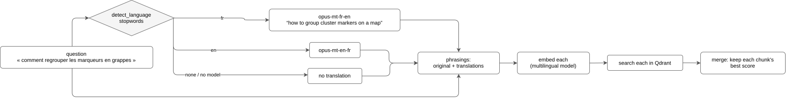
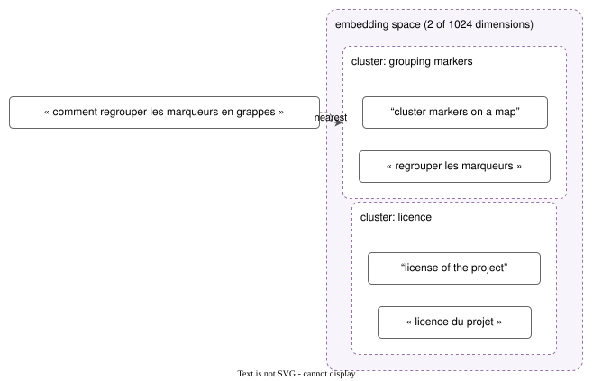
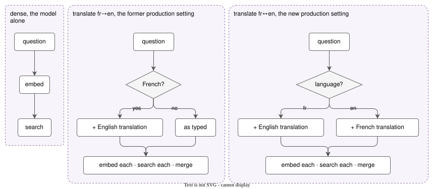

# Multilingual retrieval

The corpus is mostly English, with French pages here and there, and questions arrive in French as often as in English. A question must find its page **whatever the language of the question and of
the page**.

## How it works

### 1. A multilingual embedding space

[Qwen3-Embedding-0.6B](https://huggingface.co/Qwen/Qwen3-Embedding-0.6B) places a text according to
its meaning, not its language: a French question lands near the English passage that answers it.

| Case | Crosses languages? |
| --- | --- |
| **Shared anchor**: a product name, a URL, an identifier (`KLayerList`, `k-clone`) | yes, it is the same token in both languages |
| **Diverging vocabulary**: « grappes » / *cluster* | only partly: the words share no sub-word, the right page ranks lower |

### 2. Query translation, both ways

The diverging-vocabulary gap is lexical, and a translation fixes lexical gaps. The question is
translated by small [Marian](https://marian-nmt.github.io/) models
([Helsinki-NLP OPUS-MT](https://github.com/Helsinki-NLP/Opus-MT)), not by an LLM:

| Model | Direction | Reaches |
| --- | --- | --- |
| `Helsinki-NLP/opus-mt-fr-en` | French → English | the English pages from a French question |
| `Helsinki-NLP/opus-mt-en-fr` | English → French | the French pages from an English question |

About 75 M parameters and 300 MB each, tens of milliseconds on CPU, baked into the API image.

### 3. Searching every phrasing

- The **original question is always searched**: it carries the identifiers, and it is the phrasing
  that reaches the pages written in its own language.
- Each translation is searched too, and each passage keeps the **best score** any phrasing gave it.
- The language is detected from the question's function words (English, French, Spanish, German,
  Italian). A question with no clear language, bare keywords, is searched as typed.
- `/ask` sends the LLM the question as typed and asks it to answer in that language.

:::tip Configuration
`QUERY_TRANSLATION_MODEL` takes one Marian model or several, comma-separated; empty turns
translation off. The API image bakes in `Helsinki-NLP/opus-mt-fr-en,Helsinki-NLP/opus-mt-en-fr`;
another OPUS-MT pair plugs in by name and is downloaded at first use.
:::

:::details Example

The question that started the work, against the English documentation of `kdk`:

| Query | Best score | Section reached |
| --- | --: | --- |
| `comment grouper les marqueurs en grappes sur une carte`, no translation | 0.656 | *Dynamic building > gradient path* ✗ |
| `how to group markers into clusters on a map` | 0.760 | *GeoJson Layer > Clustering* ✓ |
| `comment regrouper les marqueurs en grappes sur une carte`, translated fr→en | 0.774 | *GeoJson Layer > Clustering* ✓ |

The translation (*"how to group cluster markers on a map"*) brings *cluster* into the search.
:::
