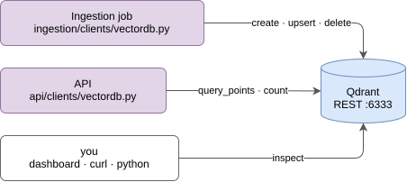
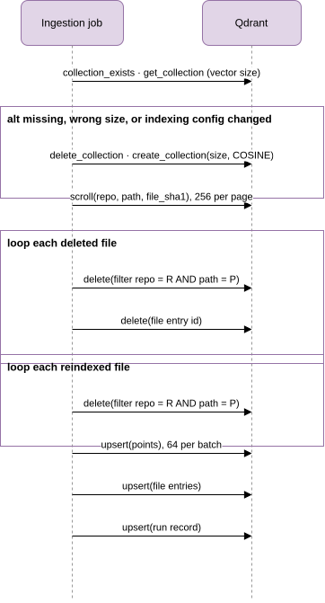

# Qdrant

[Qdrant](https://qdrant.tech/documentation/) is the vector database of knowledge.

  

:::tip Run Qdrant locally
* The `k-qdrant` helper of [`kalisio/development`](https://github.com/kalisio/development) starts Qdrant in Docker if no container named `qdrant` is running. The `knowledge` window of `k-dev kalisio services` runs it for you; `scripts/run_tests.sh` runs it in the CI.
* Qdrant ships a web UI at [http://localhost:6333/dashboard](http://localhost:6333/dashboard)
:::

## Pipeline

  

## Environment variables

| Variable | Job | API | Default | Description |
| --- | :-: | :-: | --- | --- |
| `QDRANT_URL` | ✓ | ✓ | *(required)* | REST endpoint, `http://localhost:6333` locally, `http://qdrant:6333` in the cluster |
| `QDRANT_COLLECTION_CODE` | ✓ | ✓ | *(required)* | the chunks, must be the same on both sides |
| `QDRANT_COLLECTION_METADATA` | ✓ | | *(required)* | the run record |
| `QDRANT_COLLECTION_FILES` | ✓ | | `<QDRANT_COLLECTION_CODE>_files` | the file entries |
| `QDRANT_VECTOR_SIZE_COLLECTION_CODE` | ✓ | | `1024` | dimension of the chunk vectors, the embedding model's |
| `QDRANT_VECTOR_COLLECTION_METADATA` | ✓ | | `1` | dimension of the dummy vectors |
| `QDRANT_LAST_INGESTION_KEY` | ✓ | | `last_ingestion` | payload key of the run timestamp |
