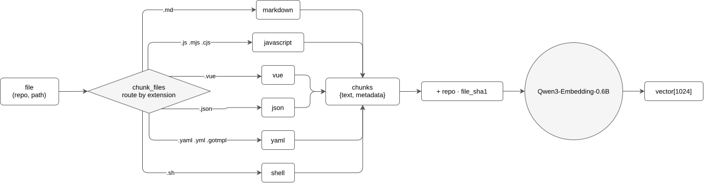
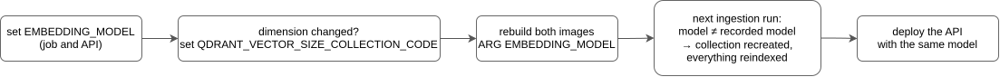
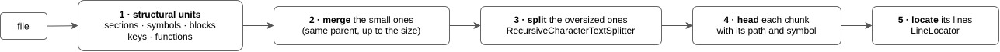
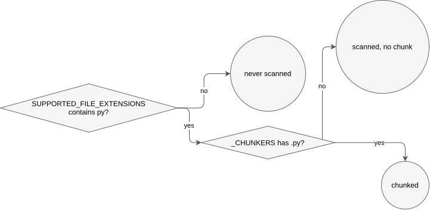

# Overview

knowledge indexes six formats. Each one has its own **chunker**.



| Format | Extensions | Chunker | Cut along |
| --- | --- | --- | --- |
| [Markdown](./markdown) | `.md` | `chunkers/markdown.py` | headings |
| [JavaScript](./javascript) | `.js` `.mjs` `.cjs` | `chunkers/javascript.py` | syntax boundaries, tagged with the top-level symbol |
| [Vue](./vue) | `.vue` | `chunkers/vue.py` | `<template>` · `<script>` · `<style>` blocks |
| [JSON](./json) | `.json` | `chunkers/json.py` | the file's role: schema properties, translation sections |
| [YAML](./yaml) | `.yaml` `.yml` `.gotmpl` | `chunkers/yaml.py` | top-level keys, Kubernetes documents |
| [Shell](./shell) | `.sh` | `chunkers/shell.py` | functions |

## The embedding model

knowledge embeds with **[Qwen3-Embedding-0.6B](https://huggingface.co/Qwen/Qwen3-Embedding-0.6B)**, published by Alibaba's Qwen team under the Apache 2.0 licence.

| Property | Value |
| --- | --- |
| Parameters | 0.6 B (28 layers) |
| Output | a **1 024-dimensional** vector, L2-normalised by knowledge |
| Context | up to 32 K tokens, every chunk fits without truncation |
| Languages | 100+ natural languages, plus programming languages |
| Built from | the [Qwen3](https://qwenlm.github.io/blog/qwen3/) language model, trained further for embeddings |
| Loaded with | [sentence-transformers](https://www.sbert.net/) (`SentenceTransformer(name, trust_remote_code=True)`) |
| Size on disk | about 1.2 GB, baked into both Docker images |
| Hardware | CPU by default; CUDA when `torch.cuda.is_available()` |

:::tip Changing the model
The job records the model it indexed with in the metadata collection, so changing it triggers a full reindex on its own

:::

## Chunkings

Files are split into smaller chunks to improve retrieval precision and give the LLM relevant, self-contained passages.

The rule: split where the format naturally separates content (headings, functions, blocks, keys), using size-based splitting only when necessary.

Oversized sections fall back to LangChain's [`RecursiveCharacterTextSplitter`](https://python.langchain.com/docs/how_to/recursive_text_splitter/), which prioritises natural boundaries.



### Keeping the context

Every chunk's text starts with where it comes from, the path, and the symbol, heading or block it belongs to. That header is embedded with the chunk:

| Format | Header of a chunk |
| --- | --- |
| Markdown | `Context: Layer catalog > Configuration > Zoom levels`<br/>`Source: docs/catalog/guide.md` |
| JavaScript | `// core/client/geolocation.js :: GeolocationTracker` |
| Vue | `// client/components/KLayerList.vue — layer list [script]` |
| JSON | `// client/i18n/en.json :: KLayerList` |
| YAML | `# .github/workflows/main.yaml :: jobs > run_tests` |
| Shell | `# kash.sh :: load_env_files` |

### Locating a chunk in its file

Each chunk stores its original line range for precise navigation. Since splitters modify formatting, `chunkers/line_locator.py` matches each chunk's non-blank lines against the source file to recover its position.

### What a chunk carries

```json
{
  "text": "Context: Layer catalog > Configuration > Zoom levels\nSource: docs/catalog/guide.md\n\n### Zoom levels\n\nSet `minZoom` and `maxZoom` ...",
  "metadata": {
    "path": "docs/catalog/guide.md",
    "chunk_index": 3,
    "breadcrumb": "Layer catalog > Configuration > Zoom levels",
    "start_line": 29,
    "end_line": 32,
    "repo": "kdk",
    "file_sha1": "…"
  }
}
```
## Add a file format


### 1. Write the chunker

A chunker is a function `chunk_<format>(text, path) -> list[dict]`:

- `text`, the whole file, already read as UTF-8;
- `path`, the file's path **inside its repository** (`src/app.py`), to use in headers;
- returns the chunks in file order, each:
```python
{
    "text": "# src/app.py :: create_app\ndef create_app():\n    ...",  # what is embedded
    "metadata": {
        "path": path,                # echo the argument
        "chunk_index": 0,            # 0, 1, 2... in order, no gap
        "breadcrumb": "create_app",  # symbol / heading / key, or ""
        "start_line": 12,            # 1-based, inclusive
        "end_line": 30,
    },
}
```

:::details The conventions
| Convention | How |
| --- | --- |
| Cut on structure first | find the format's natural units (here: top-level `def`/`class`, with their decorators) |
| Fall back on size | a unit over the limit goes through `RecursiveCharacterTextSplitter` (`from_language(Language.PYTHON)` exists) |
| Read sizes from the config | `get_config().code_chunk_size` for code, `chunk_size` for prose, never constants |
| Head every chunk | `# <path> :: <symbol>`, in the format's own comment syntax |
| Locate every chunk | `LineLocator(text).locate(piece)`, falling back to `locator.whole_file()` |
| Stay dependency-free if you can | a regular expression on column-0 definitions is what the JavaScript and shell chunkers use |
| Comment like the codebase | one comment above each function saying *why*, helpers under a `# UTILITIES` banner |
:::

### 2. Register it

`ingestion/chunkers/__init__.py` routes each extension to its chunker:

```python
from ingestion.chunkers.python import chunk_python

_CHUNKERS = {
    ...
    ".py": chunk_python,
}
```

### 3. Let the scan see it

The scan only keeps the extensions listed in `SUPPORTED_FILE_EXTENSIONS`.



### 4. Bump the chunking version

```python
# 5: Python modules are indexed.
CHUNKING_VERSION = 5
```

### 5. Test it

### 6. Document it

add a page `docs/guides/file-formats/<format>.md`