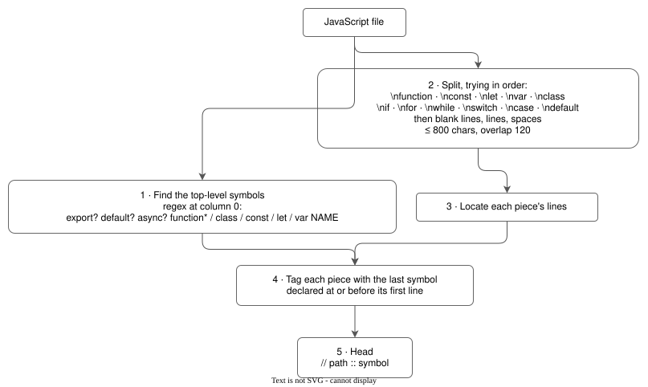
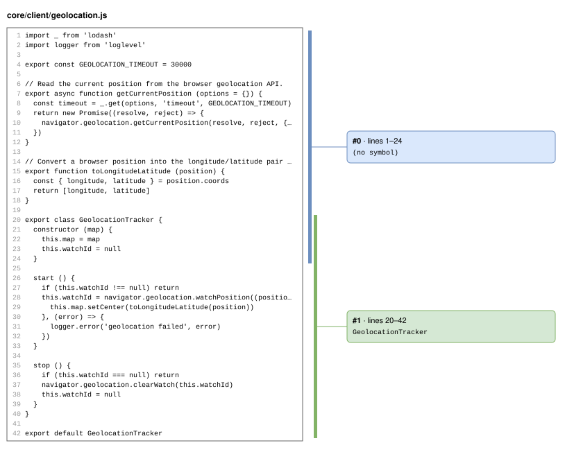

# JavaScript

| | |
| --- | --- |
| Extensions | `.js` `.mjs` `.cjs` |
| Chunker | `ingestion/chunkers/javascript.py`, `chunk_javascript(text, path)` |
| Splitter | LangChain [`RecursiveCharacterTextSplitter.from_language(Language.JS)`](https://python.langchain.com/docs/how_to/code_splitter/) |
| Size | `CODE_CHUNK_SIZE` = 800 characters, `CODE_CHUNK_OVERLAP` = 120 |
| Breadcrumb | the nearest top-level symbol above the chunk: `GeolocationTracker` |
| Header | `// <path> :: <symbol>` |
| Skipped | minified bundles (`*.min.js`, `*.bundle.js`, `*.chunk.js`), `dist/`, `build/`, `node_modules/`... |

## How a file is cut

:::details Example

:::
