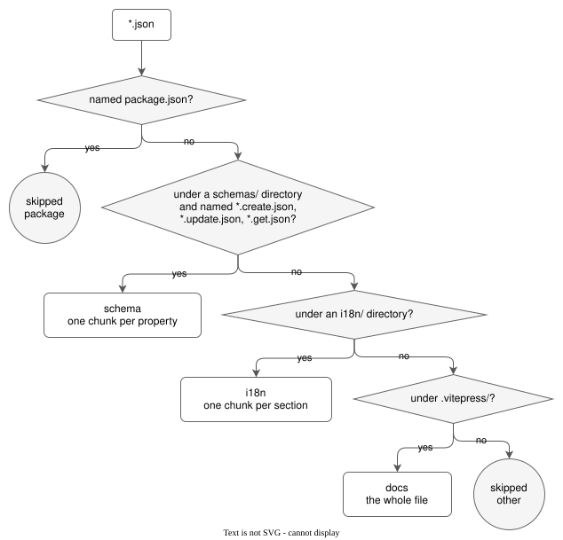
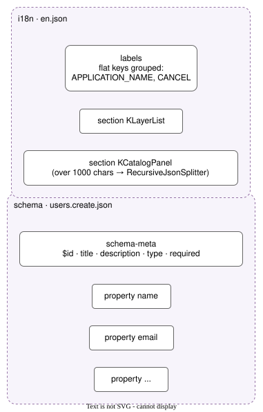
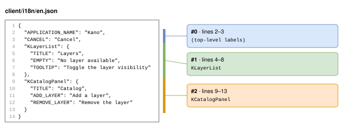

# JSON

| | |
| --- | --- |
| Extensions | `.json` |
| Chunker | `ingestion/chunkers/json.py`, `chunk_json(text, path)` |
| Parser | Python's `json`, then LangChain [`RecursiveJsonSplitter`](https://python.langchain.com/docs/how_to/recursive_json_splitter/) for oversized sections |
| Size | `CHUNK_SIZE` = 500 characters |
| Breadcrumb | the property or section: `KLayerList`, `title` |
| Header | `// <path> :: <unit>` |

## Which files are indexed

Fixtures, configurations and data files are skipped: across the Kalisio repositories they were most
of the JSON volume (test fixtures alone: 3.4 MB, about 886 000 tokens) for almost no retrieval
value. A skipped file yields no chunk and is
[remembered as such](/guides/components/ingestion-job#pipeline-d-ingestion).

## How a file is cut

:::details Example

:::
