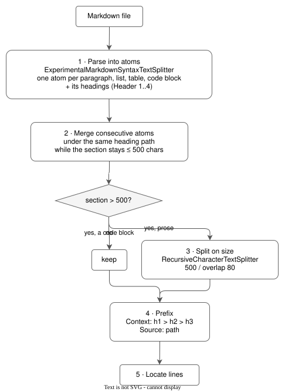
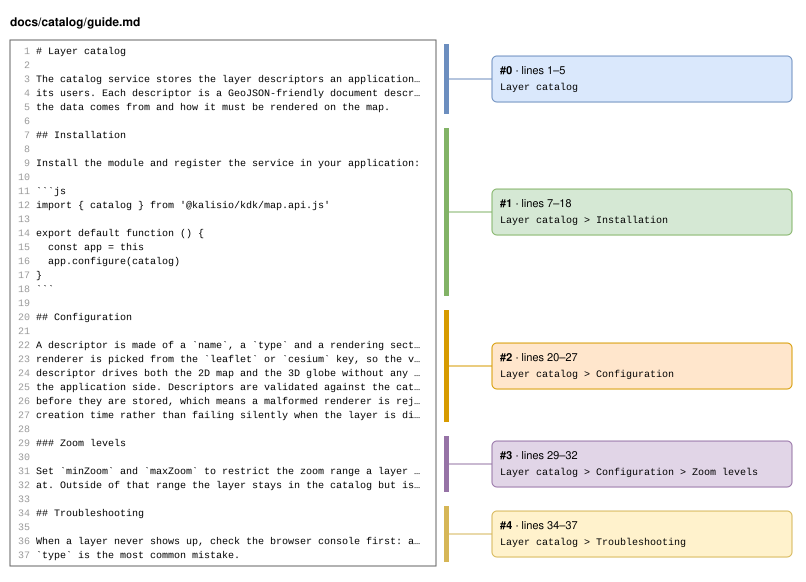

# Markdown

| | |
| --- | --- |
| Extensions | `.md` |
| Chunker | `ingestion/chunkers/markdown.py`, `chunk_markdown(text, path)` |
| Parser | LangChain [`ExperimentalMarkdownSyntaxTextSplitter`](https://python.langchain.com/api_reference/text_splitters/markdown/langchain_text_splitters.markdown.ExperimentalMarkdownSyntaxTextSplitter.html) |
| Size | `CHUNK_SIZE` = 500 characters, `CHUNK_OVERLAP` = 80 (fallback split only) |
| Breadcrumb | the heading path: `Layer catalog > Configuration > Zoom levels` |
| Skipped | `CHANGELOG.md`, `changelog.md`, `CHANGES.md`, `LICENSE.md` (by `IGNORED_FILENAMES`) |

## How a file is cut

:::details Example

:::
