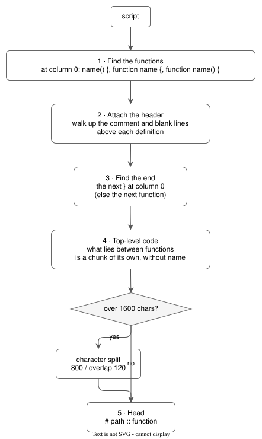
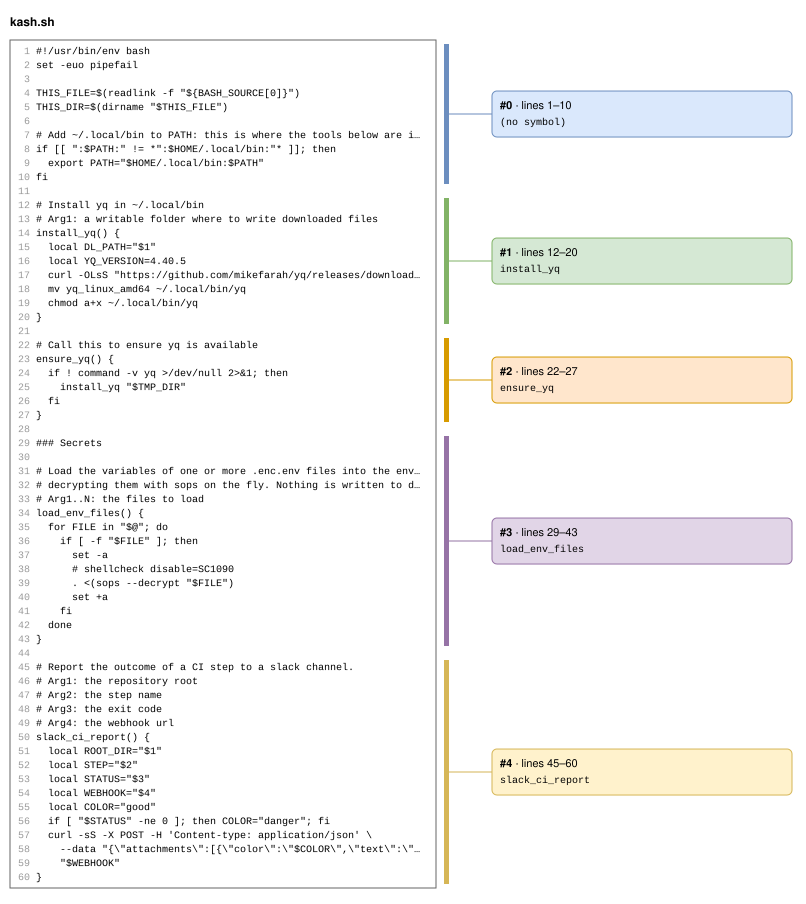

# Shell

| | |
| --- | --- |
| Extensions | `.sh` |
| Chunker | `ingestion/chunkers/shell.py`, `chunk_shell(text, path)` |
| Parser | none, function definitions found by a regular expression |
| Size | `CODE_CHUNK_SIZE` = 800 characters; a function up to 1 600 stays whole |
| Breadcrumb | the function name: `load_env_files` |
| Header | `# <path> :: <function>` |

## How a file is cut

:::details Example

:::
