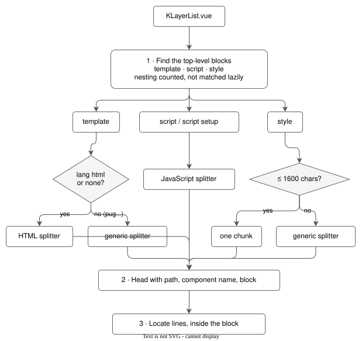
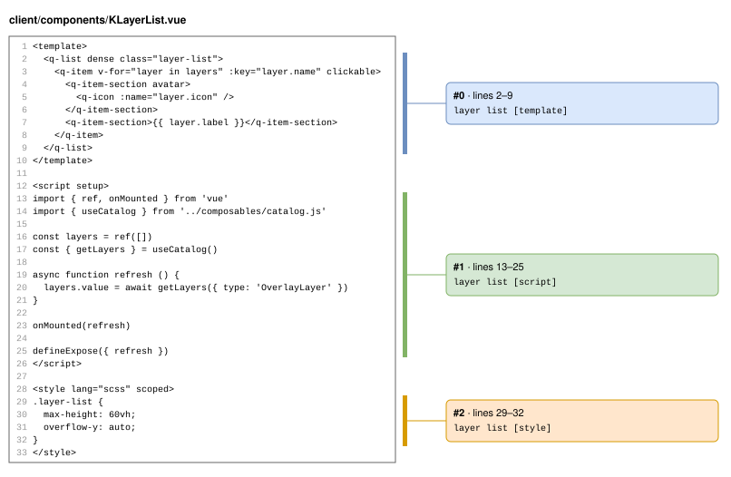

# Vue

| | |
| --- | --- |
| Extensions | `.vue` |
| Chunker | `ingestion/chunkers/vue.py`, `chunk_vue(text, path)` |
| Splitters | `from_language(Language.JS)` for `<script>`, `from_language(Language.HTML)` for `<template>`, generic otherwise |
| Size | `CODE_CHUNK_SIZE` = 800 characters, `CODE_CHUNK_OVERLAP` = 120 |
| Breadcrumb | the component name in words: `KLayerList.vue` → `layer list` |
| Header | `// <path> — <component> [script]`, `<!-- <path> — <component> [template] -->` |

## How a file is cut

:::details Example

:::
