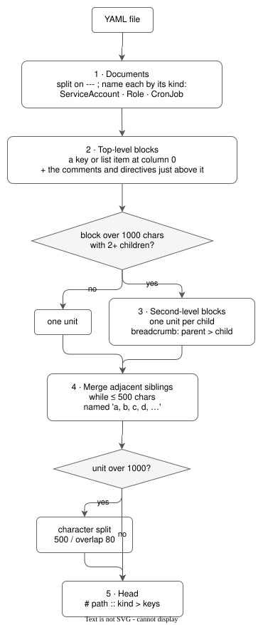
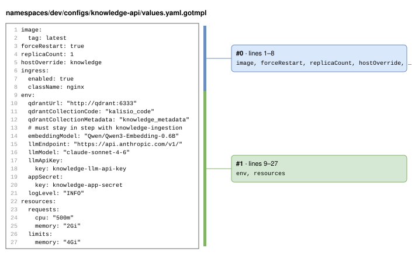
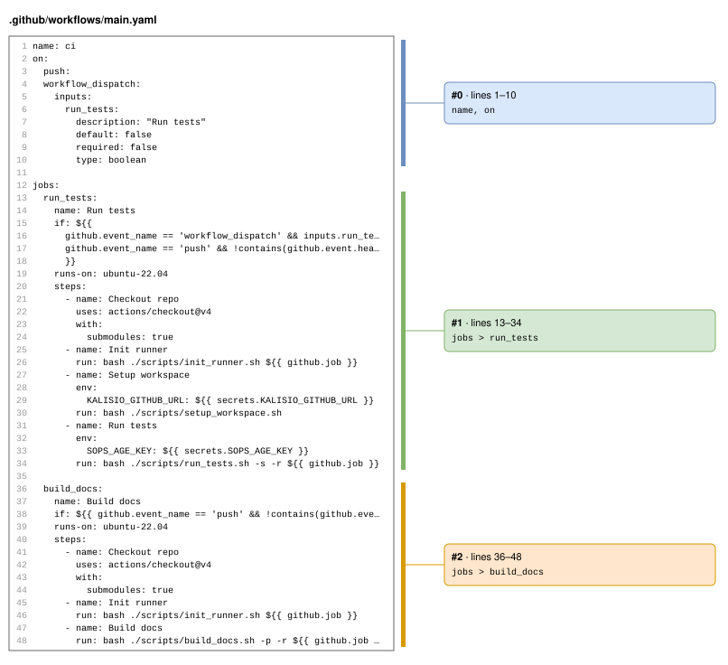
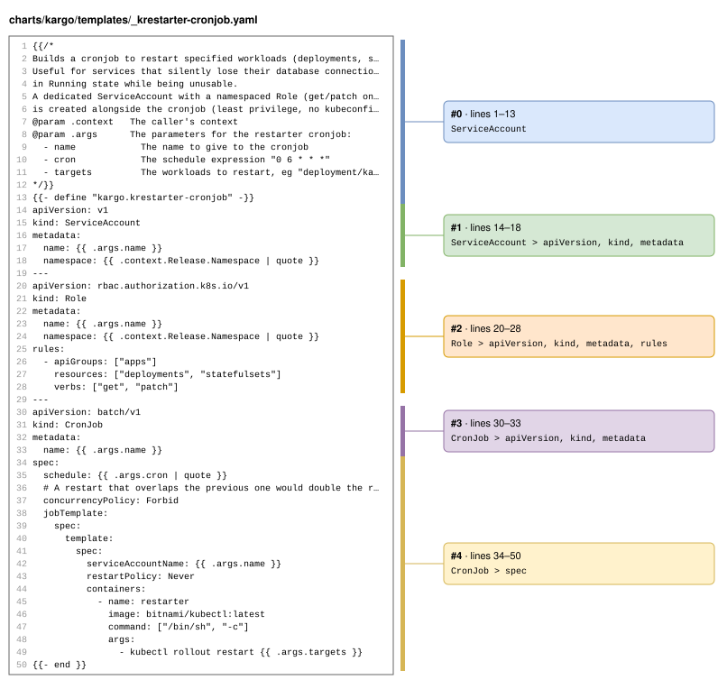

# YAML

| | |
| --- | --- |
| Extensions | `.yaml` `.yml` `.gotmpl` (`values.yaml.gotmpl`: YAML that helmfile has not rendered yet) |
| Chunker | `ingestion/chunkers/yaml.py`, `chunk_yaml(text, path)` |
| Parser | none, the file is cut on **indentation** |
| Size | `CHUNK_SIZE` = 500 characters; a unit up to 1 000 stays whole |
| Breadcrumb | kind and key path: `CronJob > spec`, `jobs > run_tests`, `image, forceRestart, replicaCount, …` |
| Header | `# <path> :: <breadcrumb>` |
| Skipped | `pnpm-lock.yaml`, `*-lock.yaml`, SOPS files (`*.enc.yaml`, `*.dec.yaml`) |

## Why not parse it

::: v-pre
A `values.yaml.gotmpl` is not valid YAML until helmfile renders it, and a Helm template is not
either: `{{ .Values.x }}`, `{{- if }}`, `{{/* comments */}}` sit anywhere. A YAML parser fails on
them, and loses comments anyway. Indentation is the one structure every one of these files keeps,
so the chunker reads lines, not a tree.
:::

## How a file is cut

:::details Examples
**A values file**

**A workflow**

**A Helm template with three documents**

:::
