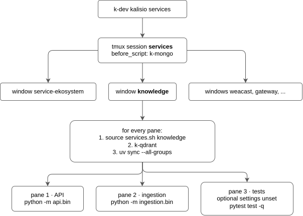

# Getting started


## Prerequisites

### The Kalisio development toolbox

knowledge relies on [`kalisio/development`](https://github.com/kalisio/development) twice: to run locally (the encrypted environment, `k-qdrant`, the `k-dev` session) and inside the ingestion job itself (`k-clone` fills the workspace it indexes). Install it first, following its [installation guide](https://github.com/kalisio/development#installation)

### Docker

[Qdrant](https://qdrant.tech/documentation/quickstart/) runs in a Docker container, started by
`k-qdrant`.

### uv

Both services are Python 3.11, managed with [uv](https://docs.astral.sh/uv/).

## Quick Start



```bash
# Get the code
k-clone kalisio services
# Create the Python environment
cd $KALISIO_DEVELOPMENT_DIR/knowledge
uv sync                          # services + test group (pytest, ruff)
uv sync --all-groups             # + the research group, for docs/experiments
source .venv/bin/activate
# Run with `k-dev`
k-dev kalisio services
# Index a corpus
python -m ingestion.bin
# Serve the API
python -m api.bin
# Run the tests
pytest test -q                       # everything; e2e tests skip without Qdrant
pytest test/api test/ingestion -q    # unit tests only, no service needed
pytest test/e2e -q                   # needs Qdrant at $QDRANT_URL
pytest test/multilingual -q -s       # retrieval quality, needs the models in the HF cache
ruff check .                         # lint (rules in pyproject.toml)
```

::: tip Run without tmux

```bash
source $KALISIO_DEVELOPMENT_DIR/development/workspaces/services/services.sh knowledge
k-qdrant                                   # Qdrant in Docker, data in ./qdrant_data
cd $KALISIO_DEVELOPMENT_DIR/knowledge && uv sync && source .venv/bin/activate
```
:::

## Configure the environment

```bash
source $KALISIO_DEVELOPMENT_DIR/development/workspaces/services/services.sh knowledge
```
:::tip Configure without the encrypted environment
```bash
export QDRANT_URL=http://localhost:6333
export QDRANT_COLLECTION_CODE=kalisio_code_dev
export QDRANT_COLLECTION_METADATA=knowledge_metadata_dev
export EMBEDDING_MODEL=Qwen/Qwen3-Embedding-0.6B
export DEVELOPMENT_DIR=$(dirname "$KALISIO_DEVELOPMENT_DIR")
export INDEXED_REPOSITORIES=kdk
export LLM_ENDPOINT=http://localhost:11434/v1/   # a local Ollama, for instance
export LLM_MODEL=qwen2.5:7b
export LLM_API_KEY=unused
export KNOWLEDGE_AUTH_ENABLED=false
```
:::