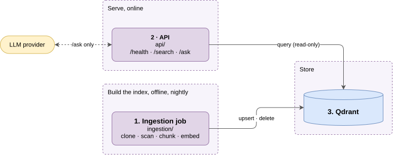
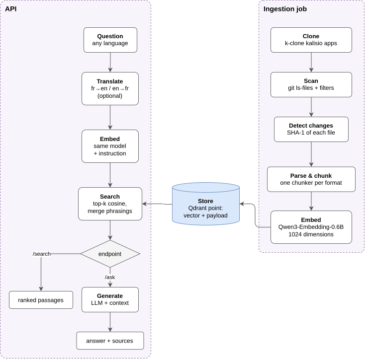

# Understanding knowledge

knowledge is a [RAG](/about/introduction) **specialised in the Kalisio ecosystem**. It indexes the Kalisio repositories (source code, documentation, helm charts etc.) and answers questions about them, with the passages it answered from.

## Components

| Component | Role | Guide |
| --- | --- | --- |
| **Ingestion job** | Builds and maintains the index: clones the repositories, cuts every supported file into chunks, embeds them, writes them to Qdrant, only what changed since the last run | [Ingestion job](/guides/components/ingestion-job) |
| **API** | Reads the index: embeds a question, searches Qdrant, returns the passages or an answer written by an LLM | [API](/guides/components/api) |
| **Qdrant** | Stores one vector + payload per chunk, finds the nearest ones to a query vector | [Qdrant](/guides/components/qdrant) |

:::info 
The job and the API share **no code**: they are two images, deployed apart, and their only contract is the shape of what they store in and read from Qdrant, plus one rule: **both must use the same embedding model**, or a question vector and a chunk vector are not comparable.
:::

## Workflow

Every passage knowledge returns has made the same journey:

### 1. Clone & scan

The job fills a workspace with the repositories of a [kli](https://github.com/kalisio/kli) workspace by running `k-clone` from [`kalisio/development`](https://github.com/kalisio/development). It then lists the files and keeps those with a supported extension. See [Ingestion job › Scanning](/guides/components/ingestion-job#pipeline-d-ingestion).

### 2. Parse & chunk

| Format | Extensions | Cut along | Guide |
| --- | --- | --- | --- |
| Markdown | `.md` | headings, sections merged up to 500 characters, code blocks never split | [Markdown](/guides/file-formats/markdown) |
| JavaScript | `.js` `.mjs` `.cjs` | JavaScript syntax boundaries, each chunk tagged with its top-level symbol | [JavaScript](/guides/file-formats/javascript) |
| Vue | `.vue` | the `<template>`, `<script>`, `<style>` blocks, each split with the right splitter | [Vue](/guides/file-formats/vue) |
| JSON | `.json` | its role: a schema per property, a translation file per section; other JSON skipped | [JSON](/guides/file-formats/json) |
| YAML | `.yaml` `.yml` `.gotmpl` | top-level keys (then second-level ones for large keys), Kubernetes documents by kind | [YAML](/guides/file-formats/yaml) |
| Shell | `.sh` | functions, with their comment header | [Shell](/guides/file-formats/shell) |

### 3. Embed

Each chunk is turned into a **1 024-dimensional vector** by
[Qwen3-Embedding-0.6B](https://huggingface.co/Qwen/Qwen3-Embedding-0.6B), an open, multilingual, code-aware model. See [File formats › The embedding model](/guides/file-formats/#the-embedding-model).

### 4. Store

Each chunk becomes one **Qdrant point**: the vector, plus a payload holding the text, the repository, the path, the line range, the breadcrumb and the digests that drive change detection. See [Qdrant](/guides/components/qdrant).

### 5. Search

The API embeds the question with the same model and asks Qdrant for the nearest chunks. Because the model is multilingual, a French question already reaches English passages; to close the remaining gap, the API can also translate the question with small [Marian](https://marian-nmt.github.io/) models (French → English and English → French), search every phrasing, and keep each passage's best score. See [API › Multilingual retrieval](/guides/components/api#multilingual-retrieval).

### 6. Generate

`/search` stops there and returns the passages. `/ask` goes on: it packs the passages into a context (up to 14 000 characters), adds an instruction and the question, and sends them to an LLM through any [OpenAI-compatible](https://platform.openai.com/docs/api-reference/chat) endpoint, Anthropic, OpenAI, Mistral, a local Ollama... The answer comes back in the language of the question, with the passages it was written from. See [API › POST /ask](/guides/components/api#post-ask-retrieval-augmented-answer).